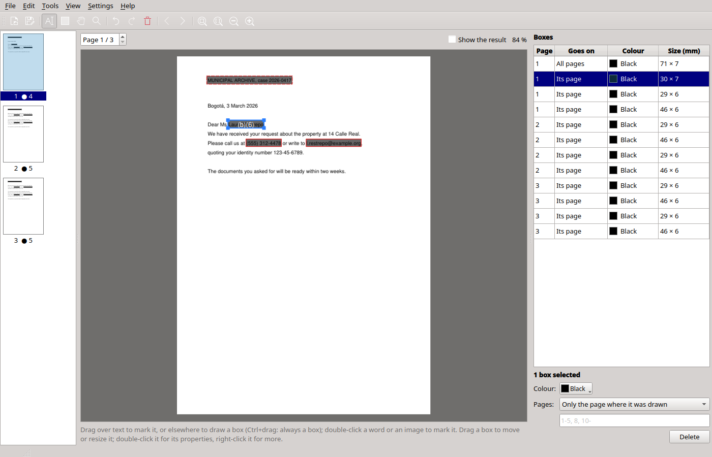
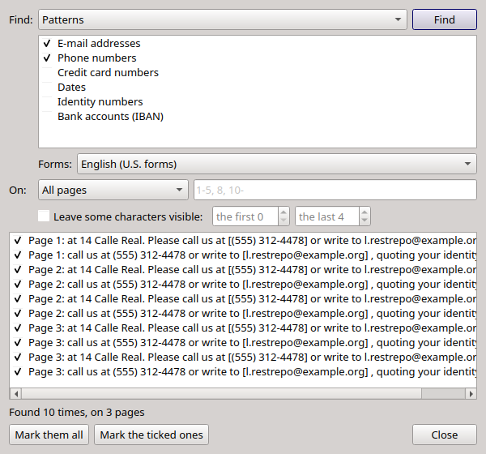

py-redact
=========

*(Español: [README_es.md](README_es.md))*

py-redact redacts PDF documents. You mark on the pages what must go (a
name, a phone number, a header that repeats on every page, a picture), and
in the redacted copy whatever lies under each mark is removed for good: the
text, the part of the images under it, the drawings it covers, and the
annotations and form fields that touch it. The place is then filled with a
colour of your choice, white included, or left as it is, and a text can be
written over it, such as `REDACTED` or a code of the U.S. FOIA exemptions.

This is not the same as drawing a black rectangle over the text. A
rectangle hides the text from the eye, but the text is still in the file,
and anyone can select it, copy it or search for it. py-redact takes it out
of the file, and after saving it checks the copy to make sure that nothing
which was under a mark can still be read there.

It has a window, in English and in Spanish, and works on Linux. Marking
follows the way of Xodo and of Adobe Acrobat Pro: drag over text to mark
it, or elsewhere to draw a box; find and mark every place where a word, a
list of words or a pattern (phone numbers, e-mail addresses, card numbers,
dates, identity numbers, bank accounts) appears; repeat a mark on other
pages; and remove the hidden information of a document (metadata, attached
files, bookmarks, comments, hidden text, scripts). The redacted copy can
also be saved as PDF/A or PDF/X.

I am Nicolas Vaughan (<nivaca@fastmail.com>), and I wrote it in 2026. It is
free software, under the GNU General Public License, version 3 or later
(see "Licensing").

[Nicolas Vaughan](https://artehum.uniandes.edu.co/profesores/nicolas-vaughan/)
is Associate Professor of Literature at the School of Arts and Humanities of
the Universidad de los Andes, Bogotá, Colombia.

Screenshots
-----------

A letter with three marks: the header, which goes on every page (dashed
outline), the name, with a code written over it (selected, in blue), and
the phone number and e-mail address that the search for patterns found:

Find and redact, looking for patterns:

The properties of a mark:

These six pictures (three in each language) are made by `uv run python
tools/screenshots.py`, which draws the window out of sight, on a letter it
writes each time with made-up names and numbers, and saves them in
`docs/img/`.

Installation
------------

There are three ways to install it: the AppImage (nothing to install), the
Fedora package, or from the source. All of them are in the
[releases](https://github.com/nivaca/py-redact/releases), on GitHub and on
[Codeberg](https://codeberg.org/nivaca/py-redact/releases).

### An AppImage (any Linux)

Download `py-redact-VERSION-x86_64.AppImage`, make it executable, and run
it:

    $ chmod +x py-redact-*-x86_64.AppImage
    $ ./py-redact-*-x86_64.AppImage [file.pdf]

It holds its own Python, Qt and PyMuPDF, and runs on Linux with glibc 2.34
or later (Ubuntu 22.04, Debian 12, Fedora 35 and later). Tools such as
AppImageLauncher or Gear Lever add it to the menu of applications.

### Fedora (Copr)

    $ sudo dnf copr enable nivaca/py-redact
    $ sudo dnf install py-redact

This installs `py-redact`, a menu entry (also offered for opening PDF files)
and its icons, with Fedora's own Python, PyMuPDF and PySide6. Updates come
with `sudo dnf upgrade`. The packages are built and signed by
[Copr](https://copr.fedorainfracloud.org/coprs/nivaca/py-redact/). It needs
Fedora 45 or later.

Each release also has the RPM itself. It is signed with the author's key,
`RPM-GPG-KEY-py-redact`, which is attached to each release and is also in
the repository ([`packaging/RPM-GPG-KEY-py-redact`](packaging/RPM-GPG-KEY-py-redact)).
Its fingerprint is `8187 0643 CA22 1AF9 0C30 554E BE68 32CD 3599 4948`:

    $ sudo rpm --import RPM-GPG-KEY-py-redact
    $ sudo dnf install ./py-redact-*.noarch.rpm

### From the source

    $ git clone https://github.com/nivaca/py-redact
    $ cd py-redact
    $ uv sync
    $ uv run py-redact [file.pdf]

It needs Python 3.15 or later, [uv](https://docs.astral.sh/uv/), and, through
uv, PyMuPDF (which does the redaction) and PySide6 (the window).

### PDF/A and PDF/X

To save the redacted copy as PDF/A or PDF/X, py-redact uses another program
of mine, [py-pdfconform](https://github.com/nivaca/py-pdfconform), which
must be installed and on the PATH. Without it, those choices are greyed out
and everything else works.

Usage
-----

Open a PDF (*File ▸ Open*, Ctrl+O, by dropping it on the window, or by
giving it on the command line, `py-redact file.pdf`). A protected document
asks for its password. On the left are the pages, with the marks each one
has; in the middle, the page; on the right, the list of marks and the colour
and pages of those selected. (The window calls the marks *boxes*.)

### Marking

The window starts with the tool *Redact* (T), which works as the redaction
tools of Xodo and Acrobat:

* Dragging over text selects it, and a mark is made over each of its lines.
* Dragging anywhere else draws a box: over a picture, a drawing, a scanned
  page.
* Ctrl+drag always draws a box, even over text.
* A double click on a word marks only that word; on a picture, all of it.

The pointer shows which of them will happen: a text cursor over text, a
cross elsewhere. *Draw boxes* (B) always draws boxes, and *Hand* (H) moves
the page in the window.

A mark is moved by dragging it, and resized by dragging its edges and
corners. Ctrl+click adds a mark to the selection, Shift+drag starts a new
mark over others, Delete removes the selected marks, and Ctrl+Z undoes.

Until they are applied, marks are see-through, with a red outline (blue
when selected, dashed when they go on other pages); with the mouse over a
mark, it shows as it will be once applied. *View ▸ Show the result*
(Ctrl+R) shows the whole page as it will be.

### A mark on many pages

A mark belongs to the page where it was drawn, but it can also go on other
pages, for a header, a footer or a stamp that repeats in the same place.
Right-click it ▸ *Pages*: only its own page, all pages, odd pages, even
pages, from it to the end, up to it, or a list such as `2-10, 15, LAST`
(`LAST-1` is the page before the last; `12-` goes to the end). On a page of
a different size, the mark keeps its position, cut to the page. A new mark
is always on its own page only, whatever the mark before it was repeated
on.

### The properties of a mark

Double-click a mark, or right-click it ▸ *Properties…*:

* **Fill**: the colour of the place once redacted, any colour, or *No
  colour*, which removes what is under the mark and paints nothing.
* **Text**: written over the place (`REDACTED`, `[name]`), with its colour,
  its size (as large as fits, or a size of its own) and its alignment, and
  repeated all along the mark if wanted.
* **Note**: shown when the mouse is over the mark; it is never written in
  the PDF.
* **Locked**: the mark can't be moved, resized or deleted.
* **Save as default for new boxes**: new marks get the same fill and text.

The colour of new marks can also be chosen by right-clicking the page.

### Redaction codes

Right-click a mark ▸ *Redaction code* writes over it why it was redacted:
the codes of the U.S. FOIA exemptions (`(b)(1)` to `(b)(9)`) or of the U.S.
Privacy Act (`(d)(5)`, `(j)(1)`…), or your own. A mark may carry several
codes, which are written separated by commas: `(b)(6), (b)(7)(C)`. *Edit
the codes…* makes your own code sets, copies the ones that come with the
program, and imports and exports sets as XML files, to share them.

### Find and redact

*Tools ▸ Find and redact…* (Ctrl+F) looks for:

* **A word or phrase**, matching case or not, as whole words, or as a
  regular expression.
* **Several words or phrases** at once, one on each line, typed or read
  from a text file.
* **Patterns**: e-mail addresses, phone numbers, credit card numbers,
  dates, identity numbers and bank accounts (IBAN), in their U.S. forms or
  in those of Spain and Latin America (`601 312 4478`, `14 de marzo de
  2024`, a DNI, a cédula).

It looks on all pages, on this page, from this page to the end, or on a
list of pages. Every place found is listed with the words around it, and
clicking one shows it on its page. *Mark them all* or *Mark the ticked ones*
puts marks over them, whole or leaving some characters visible: *Leave some
characters visible: the last 4* keeps the end of a card number, so that it
can still be told apart. A phrase is found across line breaks, however it
is spaced.

Right-clicking a word offers to redact it on that page or on every page,
and right-clicking a mark with text under it offers to redact that text
wherever else it is.

### Applying the redactions

*File ▸ Save the redacted copy…* (Ctrl+S), or *Apply all redactions…* at
the top of the right-click menu, writes a copy of the document
(`NAME-redacted.pdf`) with what is under the marks removed. The original is
not changed, unless you choose its own name, and then it is asked first. A
protected document keeps its password.

The copy is then checked: every word that was under a mark is looked for,
under the same mark, in the copy. If any can still be read, a warning says
where; if none can, the status bar says so.

*File ▸ Save as* chooses what kind of PDF the copy is: a plain PDF, PDF/A-1b,
PDF/A-2b or PDF/A-3b (for archiving), or PDF/X-4 (for printing), made by
py-pdfconform. PDF/A and PDF/X can't be protected, so the copy of a
protected document comes out without its password.

Closing the window, or opening another document, with marks not yet saved
to a redacted copy, asks first.

### Hidden information

*File ▸ Remove hidden information…* shows what the document holds besides
what its pages show, and how much of each: metadata, attached files,
bookmarks, comments and markups, form fields, hidden text (such as the text
layer of a scanned page), links, actions and JavaScript, page thumbnails,
and objects that nothing uses any more. It saves a copy without what you
tick, and doesn't apply the marks. *File ▸ Sanitize the document…* removes
all of it at once. To do part of it every time a redacted copy is saved,
tick *File ▸ Also remove metadata, hidden text, attachments and scripts*.

### Settings

*Settings ▸ Settings…* keeps:

* the colour of new marks;
* what happens to the pictures under a mark: blank only the part under it
  (the usual), remove the whole picture, or leave them;
* what happens to the drawings under a mark: remove those wholly under it
  (the usual), those it touches, or none;
* whether to also remove metadata, hidden text, attachments and scripts;
* what kind of PDF to save (see above);
* the outline colour and the opacity of the marks not yet applied.

Text under a mark is always removed.

*Settings ▸ Language* changes the language of the window (English or
Spanish), and *Settings ▸ Labels in the toolbar* shows the names of its
buttons.

### Keys

| Key | What it does |
|---|---|
| Ctrl+O | Open a document |
| Ctrl+S | Save the redacted copy |
| T, B, H | The tools: Redact, Draw boxes, Hand |
| Ctrl+F | Find and redact |
| Ctrl+R | Show the result |
| Delete | Delete the selected marks |
| Ctrl+A, Escape | Select the marks of the page, select none |
| Ctrl+Z, Ctrl+Shift+Z (or Ctrl+Y) | Undo, redo |
| PgUp, PgDn, Ctrl+Home, Ctrl+End | Previous, next, first and last page |
| Ctrl+0, Ctrl+9, Ctrl++, Ctrl+− | Fit the page, fit the width, zoom in, zoom out (also Ctrl+wheel) |
| Ctrl+, | Settings |

What redaction removes
----------------------

Under each mark, py-redact removes:

* the text, letter by letter: a mark over half a word removes that half;
* the part of each picture under it, whose pixels are blanked (or the whole
  picture, or nothing, as the settings say);
* the drawings wholly under it (or those it touches, or none);
* the annotations (notes, highlights, links) and the form fields that touch
  it.

The text written over a mark is drawn on the page, but it isn't text that
can be selected or found. Then, when the copy is written, the fonts and
pictures that only the removed parts used are dropped from the file.

A scanned page is a picture: the words a person reads on it are pixels, and
are blanked like any picture. If the page also has a text layer (from OCR),
that text is removed too, as any other text.

Settings and files
------------------

The settings are kept in a small TOML file, `config.toml`, in the user's
configuration folder: `~/.config/py-redact/` on Linux, or the folder that
`$PY_REDACT_CONFIG` names. Under `[parameters]` it has the language of the
window (`interface`), the look of new marks (`redact_color`, `box_text`,
`box_text_color`, `box_font_size`, `box_align`, `box_repeat_text`), what
redaction does to pictures and drawings (`redact_images`, `redact_drawings`),
whether to clean (`redact_clean`), what kind of PDF to save
(`redact_output`), the forms of the patterns (`pattern_language`) and the
look of marks not yet applied (`mark_outline`, `mark_opacity`). A value that
is missing or wrong gives the usual one, so a file edited by hand never
stops the program; deleting the file brings back all the usual values.

The user's own redaction codes are in `codes.xml`, in the same folder. The
size of the window, the recent files and the last folder used are kept by Qt
(`~/.config/py-redact/py-redact.conf`).

How it works
------------

The redaction itself is done by [PyMuPDF](https://pymupdf.readthedocs.io/),
which can take content out of a page: for each page, py-redact adds a
redaction annotation for each mark on it, removes the annotations and form
fields that touch the marks, and applies them; then it writes the copy with
the objects that nothing uses any more taken out. The window is made with
[PySide6](https://doc.qt.io/qtforpython-6/) (Qt 6).

The program is in `src/py_redact/`:

| File | What it has |
|---|---|
| `redact.py` | Marks, their redaction, the search, the check of the copy |
| `pagesel.py` | Lists of pages (`2-10, 15, LAST`) |
| `patterns.py` | The patterns of Find and redact |
| `codes.py` | Redaction codes and code sets |
| `hidden.py` | Hidden information: what a document has, and removing it |
| `conform.py` | PDF/A and PDF/X, through py-pdfconform |
| `settings.py`, `config.py` | The settings and the configuration file |
| `interface.py`, `locale/es.xml` | The language of the window |
| `gui/window.py` | The window |
| `gui/canvas.py` | The page and its marks |
| `gui/find.py`, `gui/props.py`, `gui/prefs.py`, `gui/codes_dialog.py`, `gui/hidden_dialog.py` | The dialogs |

`docs/DESCRIPTION.md` tells how it was made.

Testing
-------

    $ uv run pytest

There are 78 tests. They cover the redaction (of text, pictures, drawings,
annotations, rotated pages, protected files), the search and its patterns,
the redaction codes, the hidden information, the settings, and the window,
driven as a user would drive it: drawing, moving and resizing marks with the
mouse, marking text, finding, saving, and making PDF/A and PDF/X when
py-pdfconform is installed. A test checks that every text of the window has
its Spanish translation. The RPM runs them all again when it is built, with
Fedora's own Python and packages.

Version
-------

This is py-redact 0.4.0. `py-redact --version` says which one is installed.

Licensing
---------

py-redact is free software: you can redistribute it and/or modify it under
the terms of the GNU General Public License as published by the Free
Software Foundation, either version 3 of the License, or (at your option)
any later version. It is distributed WITHOUT ANY WARRANTY; see the
[LICENSE](LICENSE) file.

PyMuPDF is under the GNU Affero General Public License, version 3, and
PySide6 under the GNU Lesser General Public License, version 3; the AppImage
carries both.
