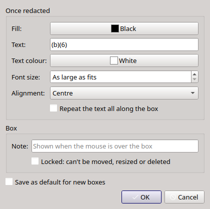

py-redact
=========

*(Español: [README_es.md](README_es.md))*

py-redact redacts PDF documents. You mark on the pages what must go (a
name, a phone number, a header that repeats on every page, a picture), and
in the redacted copy whatever lies under each mark is removed for good: the
text, the part of the images under it, the drawings it covers, and the
annotations and form fields that touch it. The place is then filled with a
colour of your choice, white included, or left as it is, and a text can be
written over it, such as `REDACTED` or a code of the U.S. FOIA exemptions.

This is not the same as drawing a black rectangle over the text. A
rectangle hides the text from the eye, but the text is still in the file,
and anyone can select it, copy it or search for it. py-redact takes it out
of the file, and after saving it checks the copy to make sure that nothing
which was under a mark can still be read there.

It has a window, in English and in Spanish, and works on Linux, Windows
and macOS. Drag over
text to mark it, or elsewhere to draw a box; find and mark every place where a word, a
list of words or a pattern (phone numbers, e-mail addresses, card numbers,
dates, identity numbers, bank accounts) appears; repeat a mark on other
pages; and remove the hidden information of a document (metadata, attached
files, bookmarks, comments, hidden text, scripts). The redacted copy can
also be saved as PDF/A or PDF/X.

I am Nicolas Vaughan (<nicolasvaughan@proton.me>), and I wrote it in 2026. It is
free software, under the GNU General Public License, version 3 or later
(see "Licensing").

[Nicolas Vaughan](https://artehum.uniandes.edu.co/profesores/nicolas-vaughan/)
is Associate Professor of Literature at the School of Arts and Humanities of
the Universidad de los Andes, Bogotá, Colombia.

Screenshots
-----------

A letter with three marks: the header, which goes on every page (dashed
outline), the name, with a code written over it (selected, in blue), and
the phone number and e-mail address that the search for patterns found:

Find and redact, looking for patterns:

The properties of a mark:

These six pictures (three in each language) are made by `uv run python
tools/screenshots.py`, which draws the window out of sight, on a letter it
writes each time with made-up names and numbers, and saves them in
`docs/img/`.

Installation
------------

### What is needed

* **Linux**: the AppImage needs nothing else: it brings its own Python, Qt
  and PyMuPDF, and runs with glibc 2.34 or later (Ubuntu 22.04, Debian 12,
  Fedora 35 and later). The Fedora package needs Fedora 45 or later, and
  brings in Fedora's own Python, PyMuPDF and PySide6.
* **Windows and macOS** (and Linux, if you prefer it): Python 3.14 or later.
  The installer of the source (see "With the installers") installs PyMuPDF
  and PySide6 for py-redact alone; there are no binaries to download.
* **From the source**, by hand: Python 3.14 or later and
  [uv](https://docs.astral.sh/uv/), which brings the rest.

To save PDF/A or PDF/X, any of them needs
[pdf2iso](https://github.com/nivaca/pdf2iso) (see "PDF/A and PDF/X").

### Getting the program

Every version is in the
[releases](https://github.com/nivaca/py-redact/releases), on GitHub and on
[Codeberg](https://codeberg.org/nivaca/py-redact/releases), with these
files:

    py-redact-VERSION.zip                 the source, as a zip, with the installers
    py-redact-VERSION-x86_64.AppImage     the AppImage (Linux)
    py-redact-VERSION-1.fc45.noarch.rpm   the Fedora package, signed
    RPM-GPG-KEY-py-redact                 the key that signs it
    py_redact-VERSION.tar.gz              the source package, for Python
    py_redact-VERSION-py3-none-any.whl    the wheel, for Python

The source can also be cloned:

    $ git clone https://github.com/nivaca/py-redact.git

### With the installers (Windows, macOS, Linux)

The folder `install/` of the source has an installer for each system. Each
one makes a Python environment of its own for py-redact, installs py-redact
in it with PyMuPDF and PySide6 (downloaded from PyPI, so it needs internet
the first time, and some minutes), and adds it to the menu of the system.
Nothing is compiled, nothing needs administrator rights, and the settings
are never touched. First install Python 3.14 or later, if it isn't there
yet, then download `py-redact-VERSION.zip` and unpack it (or clone the
source).

**Windows.** Python comes from
[python.org](https://www.python.org/downloads/windows/). Then double-click
`install\install.bat` in the unpacked folder, or run it from a command
prompt:

    > install\install.bat              install, or update
    > install\install.bat -Desktop     also a shortcut on the desktop
    > install\install.bat -Python C:\path\to\python.exe
    > install\install.bat -Uninstall

It looks for Python with the `py` launcher (`py -3.14` and later) and as
`python`. It installs py-redact in `%LOCALAPPDATA%\py-redact\venv` and adds
*py-redact* to the Start menu. From a command prompt, the program is
`%LOCALAPPDATA%\py-redact\venv\Scripts\py-redact.exe [file.pdf]`.
(`install.bat` only runs `install.ps1` with PowerShell, allowing that one
script to run.)

**macOS.** Python comes from
[python.org](https://www.python.org/downloads/macos/) or from Homebrew
(`brew install python@3.14`). Then, in the Terminal, in the unpacked
folder:

    $ install/install.sh                 install, or update
    $ install/install.sh --python /path/to/python3.14
    $ install/install.sh --uninstall

It installs py-redact in `~/Library/Application Support/py-redact/venv`
and makes `~/Applications/py-redact.app`, which starts it from the Finder,
Launchpad or Spotlight. The app is a small script that runs that Python,
not a binary. (If the zip was unpacked without the permission to run the
installer, `bash install/install.sh` runs it all the same.)

**Linux.** The same `install/install.sh`. It installs py-redact in
`~/.local/share/py-redact/venv`, with a menu entry (also offered for opening
PDF files) and its icons. Debian and Ubuntu need the `venv` module of their
Python as a package of its own (`python3.14-venv`).

On macOS and Linux, the command `py-redact` is linked in `~/bin`, if that
folder exists, or else in `~/.local/bin`. The installers look for
`python3.14` and later, and for `python3`, and use the first that is 3.14 or
later; `--python` (or `-Python`) gives another one.

### An AppImage (any Linux)

Download `py-redact-VERSION-x86_64.AppImage`, make it executable, and run
it:

    $ chmod +x py-redact-*-x86_64.AppImage
    $ ./py-redact-*-x86_64.AppImage [file.pdf]
    $ ./py-redact-*-x86_64.AppImage --version

Tools such as AppImageLauncher or Gear Lever add it to the menu of
applications.

### Fedora (Copr)

    $ sudo dnf copr enable nivaca/py-redact
    $ sudo dnf install py-redact

This installs `py-redact`, a menu entry (also offered for opening PDF files),
its icons and these documents, with Fedora's own Python, PyMuPDF and
PySide6. The packages are built and signed by
[Copr](https://copr.fedorainfracloud.org/coprs/nivaca/py-redact/), for
Fedora 45 and Rawhide.

Each release also has the RPM itself. It is signed with the author's key,
`RPM-GPG-KEY-py-redact`, which is attached to each release and is also in
the repository ([`packaging/RPM-GPG-KEY-py-redact`](packaging/RPM-GPG-KEY-py-redact)).
Its fingerprint is `8187 0643 CA22 1AF9 0C30 554E BE68 32CD 3599 4948`:

    $ sudo rpm --import RPM-GPG-KEY-py-redact
    $ sudo dnf install ./py-redact-*.noarch.rpm

### From the source, with uv

In the folder of the source (cloned, or the zip unpacked):

    $ uv sync
    $ uv run py-redact [file.pdf]

The first `uv sync` makes a virtual environment in `.venv` and installs
PyMuPDF and PySide6 in it; nothing is installed elsewhere. To have the
command `py-redact` everywhere, install it as a uv tool, which puts it in
`~/.local/bin`:

    $ uv tool install .

### A menu entry

The installers, the AppImage (through AppImageLauncher or Gear Lever) and
the Fedora package have their own. For the uv tool on Linux, copy the menu
entry and the icons to your folder of applications:

    $ install -Dm644 packaging/py-redact.desktop ~/.local/share/applications/py-redact.desktop
    $ cp -r src/py_redact/icons/linux/hicolor ~/.local/share/icons/

The entry runs `py-redact`, so `~/.local/bin` must be on the PATH of the
desktop session (it usually is). It is also offered for opening PDF files.

### PDF/A and PDF/X

To save the redacted copy as PDF/A or PDF/X, py-redact uses another program
of mine, [pdf2iso](https://github.com/nivaca/pdf2iso) (it needs
Ghostscript). py-redact looks for it, as `pdf2iso` or
`pdf2iso.py`, on the PATH and in `~/bin` and `~/.local/bin` (or, if it is older than its version 2.0, as `py-pdfconform` or `py-pdfconform.py`); a program
started from the menu of the desktop often doesn't have those two folders on
its PATH. If it is elsewhere, give its path in *Settings ▸ Settings… ▸
pdf2iso*, which says which one will be used. A script that can't be
run by itself is run with `python3`. Without it, those choices are greyed
out and everything else works.

### Updating

The Fedora package is updated with the rest of the system, `sudo dnf
upgrade`. The AppImage is replaced by the new one. With the installers,
unpack the new zip (or `git pull`) and run the installer again: it makes
the environment anew. From the source, `git
pull` (or the new zip) and then `uv sync`, or `uv tool install --reinstall .`
for the uv tool. The settings and the redaction codes are kept.

### Uninstalling

    $ sudo dnf remove py-redact                  # the Fedora package
    $ sudo dnf copr disable nivaca/py-redact     # and its repository
    $ uv tool uninstall py-redact                # the uv tool
    $ install/install.sh --uninstall             # the installer (Linux, macOS)
    > install\install.bat -Uninstall             # the installer (Windows)

The AppImage, or the folder of the source, is simply deleted, and so are the
menu entry and the icons copied by hand
(`~/.local/share/applications/py-redact.desktop`,
`~/.local/share/icons/hicolor/*/apps/py-redact.*`). The settings and the
redaction codes stay in `~/.config/py-redact/` (see "Settings and files"),
to be deleted too if they are not wanted.

What is where
-------------

    install/                the installers: install.sh (Linux, macOS),
                            install.bat and install.ps1 (Windows)
    src/py_redact/          the program (see "How it works")
      locale/es.xml         the Spanish of the window
      icons/                its icon, in every size, and those of the toolbar
                            (source/: the plainer drawing for the small sizes)
    tests/                  the tests (see "Testing")
    docs/                   DESCRIPTION.md and DESCRIPCIÓN_es.md: how it was
                            made; img/: the screenshots of this README
    packaging/              the Fedora package: its spec, build-rpm.sh, the
                            menu entry, the public key, RELEASING.md
    tools/                  scripts to make the AppImage, the screenshots and
                            the releases
    pyproject.toml          the Python project: version, dependencies
    uv.lock                 the exact versions of the dependencies

Each package is made by one command:

    $ uv build                                   # the wheel and the source package, in dist/
    $ uv run python tools/bundle-appimage.py     # the AppImage, in dist/
    $ packaging/build-rpm.sh [--sign]            # the RPM, in build/rpm/
    $ uv run python tools/screenshots.py         # the screenshots, in docs/img/
    $ uv run python tools/icons.py               # the PNG icons, from the SVG ones (Inkscape)

`tools/bundle-appimage.py` downloads, the first time, a Python made for
AppImages ([python-appimage](https://github.com/niess/python-appimage)) and
[appimagetool](https://github.com/AppImage/appimagetool), installs py-redact
in that Python, makes a redaction with it to be sure that it works, and
writes the AppImage. `packaging/build-rpm.sh` builds the RPM with Fedora's
own Python and packages, running all the tests; `--sign` signs it.
`tools/release.py` does all of it and publishes a version on GitHub,
Codeberg and Copr; `packaging/RELEASING.md` tells how.

Usage
-----

Open a PDF (*File ▸ Open*, Ctrl+O, by dropping it on the window, or by
giving it on the command line, `py-redact file.pdf`). A protected document
asks for its password. On the left are the pages, with the marks each one
has; in the middle, the page; on the right, the list of marks and the colour
and pages of those selected. (The window calls the marks *boxes*.)

### Marking

The window starts with the tool *Redact* (T), which marks text and areas
alike:

* Dragging over text selects it, and a mark is made over each of its lines.
* Dragging anywhere else draws a box: over a picture, a drawing, a scanned
  page.
* Ctrl+drag always draws a box, even over text.
* A double click on a word marks only that word; on a picture, all of it.

The pointer shows which of them will happen: a text cursor over text, a
cross elsewhere. *Draw boxes* (B) always draws boxes, and *Hand* (H) moves
the page in the window.

A mark is moved by dragging it, and resized by dragging its edges and
corners. Ctrl+click adds a mark to the selection, Shift+drag starts a new
mark over others, Delete removes the selected marks, and Ctrl+Z undoes.

Until they are applied, marks are see-through, with a red outline (blue
when selected, dashed when they go on other pages); with the mouse over a
mark, it shows as it will be once applied. *View ▸ Show the result*
(Ctrl+R) shows the whole page as it will be.

### A mark on many pages

A mark belongs to the page where it was drawn, but it can also go on other
pages, for a header, a footer or a stamp that repeats in the same place.
Right-click it ▸ *Pages*: only its own page, all pages, odd pages, even
pages, from it to the end, up to it, or a list such as `2-10, 15, LAST`
(`LAST-1` is the page before the last; `12-` goes to the end). On a page of
a different size, the mark keeps its position, cut to the page. A new mark
is always on its own page only, whatever the mark before it was repeated
on.

### The properties of a mark

Double-click a mark, or right-click it ▸ *Properties…*:

* **Fill**: the colour of the place once redacted, any colour, or *No
  colour*, which removes what is under the mark and paints nothing.
* **Text**: written over the place (`REDACTED`, `[name]`), with its colour,
  its size (as large as fits, or a size of its own) and its alignment, and
  repeated all along the mark if wanted.
* **Note**: shown when the mouse is over the mark; it is never written in
  the PDF.
* **Locked**: the mark can't be moved, resized or deleted.
* **Save as default for new boxes**: new marks get the same fill and text.

The colour of new marks can also be chosen by right-clicking the page.

### Redaction codes

Right-click a mark ▸ *Redaction code* writes over it why it was redacted:
the codes of the U.S. FOIA exemptions (`(b)(1)` to `(b)(9)`) or of the U.S.
Privacy Act (`(d)(5)`, `(j)(1)`…), or your own. A mark may carry several
codes, which are written separated by commas: `(b)(6), (b)(7)(C)`. *Edit
the codes…* makes your own code sets, copies the ones that come with the
program, and imports and exports sets as XML files, to share them.

### Find and redact

*Tools ▸ Find and redact…* (Ctrl+F) looks for:

* **A word or phrase**, matching case or not, as whole words, or as a
  regular expression.
* **Several words or phrases** at once, one on each line, typed or read
  from a text file.
* **Patterns**: e-mail addresses, phone numbers, credit card numbers,
  dates, identity numbers and bank accounts (IBAN), in their U.S. forms or
  in those of Spain and Latin America (`601 312 4478`, `14 de marzo de
  2024`, a DNI, a cédula).

It looks on all pages, on this page, from this page to the end, or on a
list of pages. Every place found is listed with the words around it, and
clicking one shows it on its page. *Mark them all* or *Mark the ticked ones*
puts marks over them, whole or leaving some characters visible: *Leave some
characters visible: the last 4* keeps the end of a card number, so that it
can still be told apart. A phrase is found across line breaks, however it
is spaced.

Right-clicking a word offers to redact it on that page or on every page,
and right-clicking a mark with text under it offers to redact that text
wherever else it is.

### Applying the redactions

*File ▸ Save the redacted copy…* (Ctrl+S), or *Apply all N redactions…* at
the top of the right-click menu, writes a copy of the document
(`NAME-redacted.pdf`) with what is under the marks removed, always as a
plain PDF. The original is
not changed, unless you choose its own name, and then it is asked first. A
protected document keeps its password.

The copy is then checked: every word that was under a mark is looked for,
under the same mark, in the copy. If any can still be read, a warning says
where; if none can, the status bar says so.

The bookmarks of the copy are checked too, before anything else is done to
it: a bookmark may name what was redacted (a heading under a mark, kept as
the title of a bookmark), or point to a page the document doesn't have. A
title is named if it has a word that was under a mark and appears nowhere
else in the document, or if more than half of its words were under marks.
For such bookmarks, a question offers to remove them, to remove all the
bookmarks, or to keep them.

*File ▸ Save as* saves the copy, this once, as the kind of PDF chosen there:
a plain PDF, PDF/A-1b, PDF/A-2b or PDF/A-3b (for archiving), or PDF/X-4
(for printing), made by pdf2iso. Choosing it saves at once, and
nothing is remembered: the next *Save* is a plain PDF again. PDF/A and PDF/X can't be protected, so the copy of a
protected document comes out without its password.

Closing the window, or opening another document, with marks not yet saved
to a redacted copy, asks first.

### Metadata

*File ▸ Metadata…* (Ctrl+Shift+M) shows all the metadata of the document,
and lets you change what the redacted copy will have:

* the document information: title, author, subject, keywords, creator,
  producer, the dates of creation and modification (written as
  `2026-11-17 07:57:28 -05:00`, with a *Now* button) and whether it was
  trapped for printing;
* the language of the document (`es-CO`, `en-US`…);
* any other fields a program put there (a company, a case number…), which
  can be changed, and to which new ones can be added;
* the XMP metadata, an XML packet that may repeat the fields above and add
  others.

Each field has a button (✕) to remove it, and the XMP metadata has its own.
*Remove all* leaves the copy without metadata, and *The document's own*
shows again what the document has. The copy gets this metadata when it is
saved, after any cleaning; the document open is not changed. A copy can be
saved with new metadata even if it has no marks. A PDF/A or PDF/X copy may
get a producer and an XMP of its own from the conversion.

### Hidden information

*File ▸ Remove hidden information…* shows what the document holds besides
what its pages show, and how much of each: metadata, attached files,
bookmarks, page labels (the numbers a viewer shows for the pages, such as
82, 83…, which may tell where they came from), comments and markups, form
fields, hidden text (such as the text
layer of a scanned page), links, actions and JavaScript, page thumbnails,
and objects that nothing uses any more. It saves a copy without what you
tick, and doesn't apply the marks. *File ▸ Sanitize the document…* removes
all of it at once. To do part of it every time a redacted copy is saved,
tick *File ▸ Also remove metadata, hidden text, attachments and scripts*.

### Settings

*Settings ▸ Settings…* keeps:

* the colour of new marks;
* what happens to the pictures under a mark: blank only the part under it
  (the usual), remove the whole picture, or leave them;
* what happens to the drawings under a mark: remove those wholly under it
  (the usual), those it touches, or none;
* whether to also remove metadata, hidden text, attachments and scripts;
* where pdf2iso is (see "PDF/A and PDF/X");
* the outline colour and the opacity of the marks not yet applied.

Text under a mark is always removed.

*Settings ▸ Language* changes the language of the window (English or
Spanish), and *Settings ▸ Labels in the toolbar* shows the names of its
buttons.

### Keys

| Key | What it does |
|---|---|
| Ctrl+O | Open a document |
| Ctrl+S | Save the redacted copy, as a plain PDF |
| Ctrl+Shift+M | Metadata |
| T, B, H | The tools: Redact, Draw boxes, Hand |
| Ctrl+F | Find and redact |
| Ctrl+R | Show the result |
| Delete | Delete the selected marks |
| Ctrl+A, Escape | Select the marks of the page, select none |
| Ctrl+Z, Ctrl+Shift+Z (or Ctrl+Y) | Undo, redo |
| PgUp, PgDn, Ctrl+Home, Ctrl+End | Previous, next, first and last page |
| Ctrl+0, Ctrl+9, Ctrl++, Ctrl+− | Fit the page, fit the width, zoom in, zoom out (also Ctrl+wheel) |
| Ctrl+, | Settings |

### Help

Every button and menu item says what it does when the mouse is over it, and
the toolbar's tooltips give the key. The line under the page reminds how to
mark. *Help ▸ About* says the version.

### The language of the window

The window is in English or in Spanish: *Settings ▸ Language* changes it at
once, without closing the document or losing its marks, and the choice is
kept (`interface` in the configuration file). The dialogs of Qt itself (to
open and save files, to choose a colour) follow it, when Qt has their
translation.

Each text of the window is looked for, by its English, in
`src/py_redact/locale/es.xml`; a text that isn't there is shown in English.
Another language needs only another file there, `locale/CODE.xml`, made like
that one; it then appears in *Settings ▸ Language*. A test checks that the
Spanish file has every text of the program, and no other.

What redaction removes
----------------------

Under each mark, py-redact removes:

* the text, letter by letter: a mark over half a word removes that half;
* the part of each picture under it, whose pixels are blanked (or the whole
  picture, or nothing, as the settings say);
* the drawings wholly under it (or those it touches, or none);
* the annotations (notes, highlights, links) and the form fields that touch
  it.

The text written over a mark is drawn on the page, but it isn't text that
can be selected or found. Then, when the copy is written, the fonts and
pictures that only the removed parts used are dropped from the file.

A scanned page is a picture: the words a person reads on it are pixels, and
are blanked like any picture. If the page also has a text layer (from OCR),
that text is removed too, as any other text.

Settings and files
------------------

The settings are kept in a small TOML file, `config.toml`, in the user's
configuration folder: `~/.config/py-redact/` on Linux,
`~/Library/Application Support/py-redact/` on macOS and
`%APPDATA%\py-redact\` on Windows, or the folder that `$PY_REDACT_CONFIG`
names. Under `[parameters]` it has the language of the
window (`interface`), the look of new marks (`redact_color`, `box_text`,
`box_text_color`, `box_font_size`, `box_align`, `box_repeat_text`), what
redaction does to pictures and drawings (`redact_images`, `redact_drawings`),
whether to clean (`redact_clean`), where pdf2iso is (`pdfconform`),
the forms of the patterns (`pattern_language`) and the
look of marks not yet applied (`mark_outline`, `mark_opacity`). A value that
is missing or wrong gives the usual one, so a file edited by hand never
stops the program; deleting the file brings back all the usual values.

The user's own redaction codes are in `codes.xml`, in the same folder. The
size of the window, the recent files and the last folder used are kept by Qt
(`~/.config/py-redact/py-redact.conf` on Linux; in the preferences of macOS
and in the registry of Windows).

How it works
------------

The redaction itself is done by [PyMuPDF](https://pymupdf.readthedocs.io/),
which can take content out of a page: for each page, py-redact adds a
redaction annotation for each mark on it, removes the annotations and form
fields that touch the marks, and applies them; then it writes the copy with
the objects that nothing uses any more taken out. The window is made with
[PySide6](https://doc.qt.io/qtforpython-6/) (Qt 6).

The program is in `src/py_redact/`:

| File | What it has |
|---|---|
| `redact.py` | Marks, their redaction, the search, the check of the copy |
| `pagesel.py` | Lists of pages (`2-10, 15, LAST`) |
| `patterns.py` | The patterns of Find and redact |
| `codes.py` | Redaction codes and code sets |
| `hidden.py` | Hidden information: what a document has, and removing it |
| `metadata.py` | The metadata: reading it, and giving a copy exactly the metadata chosen |
| `conform.py` | PDF/A and PDF/X, through pdf2iso |
| `settings.py`, `config.py` | The settings and the configuration file |
| `interface.py`, `locale/es.xml` | The language of the window |
| `gui/window.py` | The window |
| `gui/canvas.py` | The page and its marks |
| `rendering.py`, `gui/renderer.py` | Drawing the pages in processes of their own |
| `gui/find.py`, `gui/props.py`, `gui/prefs.py`, `gui/codes_dialog.py`, `gui/hidden_dialog.py`, `gui/meta_dialog.py` | The dialogs |

The pages are drawn in two processes of their own, one for the page shown
and those next to it, the other for the thumbnails. PyMuPDF keeps Python
busy while it draws a page, and a scanned page can take a fifth of a
second; drawn in the window's own process, every page turned would stop the
window that long. So a click on a thumbnail shows that thumbnail, enlarged,
at once, and the page replaces it as soon as it is drawn; a page that is no
longer wanted is not drawn. The last pages drawn are kept, and the next and
previous ones are drawn ahead. If those processes can't be started, the
window draws the pages itself.

`docs/DESCRIPTION.md` tells how it was made.

Testing
-------

    $ uv run pytest

There are 94 tests. They cover the redaction (of text, pictures, drawings,
annotations, rotated pages, protected files), the search and its patterns,
the redaction codes, the hidden information, the settings, and the window,
driven as a user would drive it: drawing, moving and resizing marks with the
mouse, marking text, finding, saving, and making PDF/A and PDF/X when
pdf2iso is installed, the drawing of the pages in processes of their own,
and the installers. A test checks that every text of the window has
its Spanish translation. The RPM runs them all again when it is built, with
Fedora's own Python and packages.

Version
-------

This is py-redact 1.0.2. `py-redact --version` says which one is installed.

- 1.0.2:
  - The checks after saving are much faster on large documents: each page is
    read once for all its boxes (on 300 pages with 5,100 boxes, checking the
    copy went from 140 seconds to 2, and the bookmarks from 85 to 1), and
    the bookmarks are not checked when the copy has none.
- 1.0.1:
  - A new icon, with colour: a page with two lines blacked out and a red
    marker, drawn plainer for the small sizes.
- 1.0.0:
  - Installers for Linux, macOS and Windows (`install/`), which install
    py-redact from its source to run with Python 3.14 or later, in an
    environment of its own, with an entry in the menu of the system (an app
    in `~/Applications` on macOS, the Start menu on Windows).
  - The pages are drawn in processes of their own, so the window never
    waits for them: a click on a thumbnail shows it, enlarged, at once,
    and the page follows as soon as it is drawn; quick clicks no longer
    pile up.
  - On Windows, pdf2iso is run through Python.
- 0.4.9:
  - The window is lighter. A page is rendered once and kept, so drawing,
    moving or recolouring a box no longer renders it again; the next and
    previous pages are rendered while the window is idle, and only the
    thumbnails whose boxes changed are drawn again.
- 0.4.8:
  - The window answers with large documents. Marking thousands of places
    takes a second (it could take minutes), thumbnails are drawn one at a
    time, those in view first, and *Find and redact* reads each page once
    for all its terms, shows how far it has gone and can be stopped.
- 0.4.7:
  - *File ▸ Metadata…* (Ctrl+Shift+M) shows all the metadata of the
    document (document information, other fields, language, XMP) and lets
    you change what the redacted copy will have, with a button to remove
    each field. A copy can be saved with new metadata even without marks.
- 0.4.6:
  - PDF/A and PDF/X are made by pdf2iso, the new name of py-pdfconform;
    the old name is still looked for.
- 0.4.5:
  - After saving, the bookmarks of the copy are checked too: those whose
    titles name what was under the marks, or that point to no page, can
    be removed, or all the bookmarks.
  - Page labels (the numbers a viewer shows for the pages) are a kind of
    hidden information, which *Remove hidden information* and *Sanitize*
    remove.
- 0.4.4:
  - The documentation no longer names other redaction programs. The
    program is the same.
- 0.4.3:
  - *Save* always writes a plain PDF. *File ▸ Save as* writes PDF/A or
    PDF/X (or a plain PDF) this once, as soon as it is chosen, and
    remembers nothing; the kind of PDF is no longer a setting.
  - Python 3.14 or later is needed (it was 3.15); the AppImage carries
    Python 3.14.
- 0.4.2:
  - *File ▸ Save as* saves at once in the kind of PDF chosen (PDF, PDF/A,
    PDF/X), which stays ticked for the next times; before, it only chose
    it, and *Save* had to be chosen after.
- 0.4.1:
  - The documentation is complete, in English and Spanish: what is needed,
    getting the program, a menu entry, updating, uninstalling, what is
    where, help, the language of the window, this history, background and
    sources.
  - *Settings ▸ Settings… ▸ pdf2iso* says where pdf2iso is,
    and which one will be used; without it, py-redact also looks for it in
    `~/bin` and `~/.local/bin` and with the `.py` extension. Before, started
    from the menu of the desktop, it often didn't find it, and PDF/A and
    PDF/X were always greyed out.
- 0.4.0:
  - Find and redact looks for several words or
    phrases at once (typed, or read from a text file) and for patterns
    (e-mail addresses, phone numbers, credit card numbers, dates, identity
    numbers, IBAN), in their U.S. forms or in those of Spain and Latin
    America; it can leave some characters of each place visible.
  - Redaction codes: the U.S. FOIA and Privacy Act sets, and your own,
    several on a mark; an editor makes, copies, imports and exports sets.
  - A mark shows as it will be once applied when the mouse is over it.
  - *File ▸ Remove hidden information…* lists what a document holds besides
    its pages, kind by kind, and removes what is ticked; *Sanitize* removes
    all of it.
  - The outline colour and the opacity of marks not yet applied are
    settings.
  - This documentation, in English and Spanish, with screenshots.
  - *Settings…* has the key Ctrl+,.
- 0.3.0:
  - One tool for text and areas (over text it selects the text,
    elsewhere it draws a box; Ctrl+drag always draws a box); a double click
    marks a word or a picture; a hand tool.
  - The properties of a mark: a fill of any colour or none, a text written
    over it (colour, size, alignment, repeated), a note, a lock, and *Save
    as default for new boxes*.
  - Marks not yet applied are see-through with a red outline; *Apply all N
    redactions…* is in the right-click menu; the copy is checked after
    saving.
  - *File ▸ Sanitize the document…*.
  - The copy can be saved as PDF/A-1b, PDF/A-2b, PDF/A-3b or PDF/X-4, with
    pdf2iso.
  - Icons in the toolbar, from the desktop's theme or the program's own;
    *Settings ▸ Labels in the toolbar*.
- 0.2.0:
  - *Find and redact*: a word, a phrase or a regular expression, on all
    pages or some, across line breaks.
  - The text tool is the one on startup, and it also moves marks.
  - Right-click menus that offer what fits where they are opened (a word, a
    mark with text under it, the page); a *Tools* menu.
  - Right-click a mark for its pages and colour; a new mark no longer takes
    the pages of the one before; the colour of new marks is a setting; a
    settings dialog (pictures, drawings, cleaning); marking text.
- 0.1.0:
  - The first version: a window to draw marks on the pages, repeat them on
    other pages and choose their colour (white included), and save a
    redacted copy; in English and Spanish; as an AppImage and an RPM.

Background
----------

I wrote py-redact as a companion to two other programs of mine for PDF
documents, [py-foliation](https://github.com/nivaca/py-foliation), which
changes the page labels, and [py-imposition](https://github.com/nivaca/py-imposition),
which imposes pages for printing. It has their shape: the interface in two
languages, the configuration file, the packages and the way they are
published came from py-foliation, and the lists of pages from
py-imposition. `docs/DESCRIPTION.md` tells the whole story.

Sources
-------

- [PyMuPDF](https://pymupdf.readthedocs.io/), by Artifex Software, on the
  MuPDF library: the redaction, the reading of the text and the drawing of
  the pages. GNU AGPL 3.
- [PySide6](https://doc.qt.io/qtforpython-6/), Qt for Python, by The Qt
  Company: the window. GNU LGPL 3.
- [pdf2iso](https://github.com/nivaca/pdf2iso), by the author,
  with [Ghostscript](https://www.ghostscript.com/) and
  [pikepdf](https://pikepdf.readthedocs.io/): PDF/A and PDF/X.
- The codes of the U.S. Freedom of Information Act, 5 U.S.C. § 552(b), and
  of the Privacy Act of 1974, 5 U.S.C. § 552a(d)(5), (j) and (k): the two
  sets of redaction codes that come with the program.
- The icons of the toolbar follow the names of the
  [freedesktop icon naming specification](https://specifications.freedesktop.org/icon-naming-spec/),
  so the desktop's own icons are used; the program's own, for when the
  desktop has none, were drawn for it.

Licensing
---------

py-redact is free software: you can redistribute it and/or modify it under
the terms of the GNU General Public License as published by the Free
Software Foundation, either version 3 of the License, or (at your option)
any later version. It is distributed WITHOUT ANY WARRANTY; see the
[LICENSE](LICENSE) file.

PyMuPDF is under the GNU Affero General Public License, version 3, and
PySide6 under the GNU Lesser General Public License, version 3; the AppImage
carries both.
