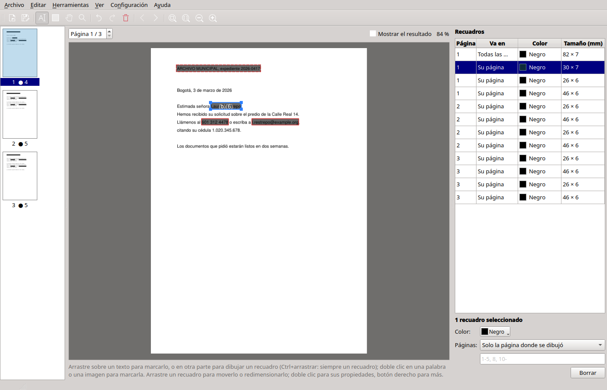
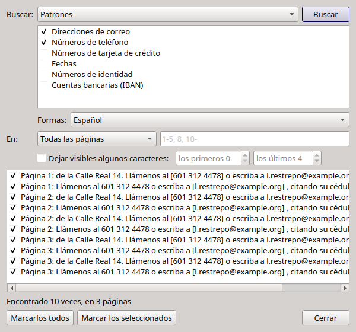
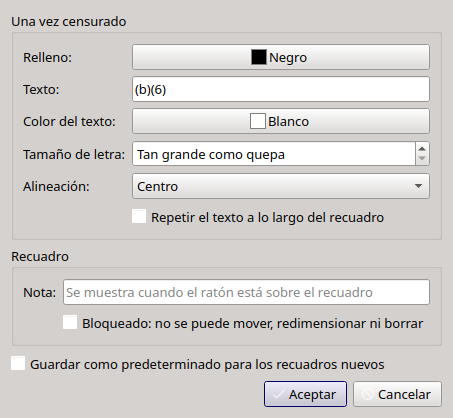

py-redact
=========

*(English: [README.md](README.md))*

py-redact censura documentos PDF. Se marca en las páginas lo que debe
desaparecer (un nombre, un número de teléfono, un encabezado que se repite
en todas las páginas, una imagen), y en la copia censurada se elimina para
siempre lo que hay debajo de cada recuadro: el texto, la parte de las
imágenes que queda debajo, los dibujos que cubre y las anotaciones y campos
de formulario que toca. El lugar se rellena luego con el color que se
elija, también blanco, o se deja como está, y encima puede escribirse un
texto, como `CENSURADO` o un código de las excepciones de la FOIA
estadounidense.

No es lo mismo que dibujar un rectángulo negro sobre el texto. El
rectángulo lo oculta a la vista, pero el texto sigue en el archivo, y
cualquiera puede seleccionarlo, copiarlo o buscarlo. py-redact lo saca del
archivo y, al guardar, revisa la copia para asegurarse de que nada de lo que
estaba debajo de un recuadro pueda leerse todavía.

Tiene una ventana, en español y en inglés, y funciona en Linux. La manera
de marcar sigue la de Xodo y la de Adobe Acrobat Pro: se arrastra sobre un
texto para marcarlo, o en otra parte para dibujar un recuadro; se buscan y
marcan todos los lugares donde aparece una palabra, una lista de palabras o
un patrón (números de teléfono, direcciones de correo, números de tarjeta,
fechas, números de identidad, cuentas bancarias); un recuadro se repite en
otras páginas, y se quita la información oculta de un documento
(metadatos, adjuntos, marcadores, comentarios, texto oculto, scripts). La
copia censurada también puede guardarse como PDF/A o PDF/X.

Soy Nicolas Vaughan (<nivaca@fastmail.com>), y lo escribí en 2026. Es
software libre, bajo la Licencia Pública General de GNU, versión 3 o
posterior (véase "Licencia").

[Nicolas Vaughan](https://artehum.uniandes.edu.co/profesores/nicolas-vaughan/)
es profesor asociado de Literatura en la Facultad de Artes y Humanidades de
la Universidad de los Andes, Bogotá, Colombia.

Capturas de pantalla
--------------------

Una carta con tres clases de recuadros: el encabezado, que va en todas las
páginas (contorno discontinuo), el nombre, con un código escrito encima
(seleccionado, en azul), y el teléfono y la dirección de correo que encontró
la búsqueda de patrones:

Buscar y censurar, con patrones:

Las propiedades de un recuadro:

Estas seis imágenes (tres en cada idioma) las hace `uv run python
tools/screenshots.py`, que dibuja la ventana fuera de la vista, sobre una
carta que escribe cada vez con nombres y números inventados, y las guarda en
`docs/img/`.

Instalación
-----------

### Qué se necesita

Linux. La AppImage no necesita nada más: trae su propio Python, Qt y
PyMuPDF, y funciona con glibc 2.34 o posterior (Ubuntu 22.04, Debian 12,
Fedora 35 y posteriores). El paquete de Fedora necesita Fedora 45 o
posterior, y usa el Python, el PyMuPDF y el PySide6 de Fedora. Desde el
código fuente hacen falta Python 3.15 o posterior y
[uv](https://docs.astral.sh/uv/), que trae lo demás (PyMuPDF y PySide6).
Para guardar PDF/A o PDF/X, cualquiera de ellos necesita
[py-pdfconform](https://github.com/nivaca/py-pdfconform) (véase "PDF/A y
PDF/X").

### Conseguir el programa

Cada versión está en las
[versiones publicadas](https://github.com/nivaca/py-redact/releases), en
GitHub y en [Codeberg](https://codeberg.org/nivaca/py-redact/releases), con
estos archivos:

    py-redact-VERSIÓN-x86_64.AppImage     la AppImage
    py-redact-VERSIÓN-1.fc45.noarch.rpm   el paquete de Fedora, firmado
    RPM-GPG-KEY-py-redact                 la clave que lo firma
    py-redact-VERSIÓN.zip                 el código fuente, en un zip
    py_redact-VERSIÓN.tar.gz              el paquete fuente, para Python
    py_redact-VERSIÓN-py3-none-any.whl    la rueda (wheel), para Python

El código fuente también puede clonarse:

    $ git clone https://github.com/nivaca/py-redact.git

### Una AppImage (cualquier Linux)

Se descarga `py-redact-VERSIÓN-x86_64.AppImage`, se hace ejecutable y se
abre:

    $ chmod +x py-redact-*-x86_64.AppImage
    $ ./py-redact-*-x86_64.AppImage [archivo.pdf]
    $ ./py-redact-*-x86_64.AppImage --version

Programas como AppImageLauncher o Gear Lever la añaden al menú de
aplicaciones.

### Fedora (Copr)

    $ sudo dnf copr enable nivaca/py-redact
    $ sudo dnf install py-redact

Instala `py-redact`, una entrada en el menú (que también se ofrece para
abrir archivos PDF), sus iconos y estos documentos, con el Python, el
PyMuPDF y el PySide6 de Fedora. Los paquetes los construye y firma
[Copr](https://copr.fedorainfracloud.org/coprs/nivaca/py-redact/), para
Fedora 45 y Rawhide.

Cada versión publicada trae además el RPM. Está firmado con la clave del
autor, `RPM-GPG-KEY-py-redact`, que va adjunta a cada versión y está también
en el repositorio ([`packaging/RPM-GPG-KEY-py-redact`](packaging/RPM-GPG-KEY-py-redact)).
Su huella es `8187 0643 CA22 1AF9 0C30 554E BE68 32CD 3599 4948`:

    $ sudo rpm --import RPM-GPG-KEY-py-redact
    $ sudo dnf install ./py-redact-*.noarch.rpm

### Desde el código fuente

En la carpeta del código (clonado, o el zip descomprimido):

    $ uv sync
    $ uv run py-redact [archivo.pdf]

El primer `uv sync` crea un entorno virtual en `.venv` e instala en él
PyMuPDF y PySide6; no se instala nada en otra parte. Para tener la orden
`py-redact` en cualquier lugar, se instala como herramienta de uv, que la
pone en `~/.local/bin`:

    $ uv tool install .

### Una entrada en el menú

La AppImage (con AppImageLauncher o Gear Lever) y el paquete de Fedora
tienen la suya. Para la herramienta de uv, se copian la entrada y los
iconos a la carpeta de aplicaciones del usuario:

    $ install -Dm644 packaging/py-redact.desktop ~/.local/share/applications/py-redact.desktop
    $ cp -r src/py_redact/icons/linux/hicolor ~/.local/share/icons/

La entrada ejecuta `py-redact`, así que `~/.local/bin` tiene que estar en el
PATH de la sesión de escritorio (suele estarlo). También se ofrece para
abrir archivos PDF.

### PDF/A y PDF/X

Para guardar la copia censurada como PDF/A o PDF/X, py-redact usa otro
programa mío, [py-pdfconform](https://github.com/nivaca/py-pdfconform)
(necesita Ghostscript). py-redact lo busca, como `py-pdfconform` o
`py-pdfconform.py`, en el PATH y en `~/bin` y `~/.local/bin`; un programa
abierto desde el menú del escritorio a menudo no tiene esas dos carpetas en
su PATH. Si está en otra parte, se indica su ruta en *Configuración ▸
Configuración… ▸ py-pdfconform*, que dice cuál se usará. Un script que no
puede ejecutarse por sí mismo se ejecuta con `python3`. Sin él, esas
opciones aparecen desactivadas y todo lo demás funciona.

### Actualizar

El paquete de Fedora se actualiza con el resto del sistema, `sudo dnf
upgrade`. La AppImage se reemplaza por la nueva. Desde el código, `git pull`
(o el zip nuevo) y luego `uv sync`, o `uv tool install --reinstall .` para la
herramienta de uv. La configuración y los códigos de censura se conservan.

### Desinstalar

    $ sudo dnf remove py-redact                  # el paquete de Fedora
    $ sudo dnf copr disable nivaca/py-redact     # y su repositorio
    $ uv tool uninstall py-redact                # la herramienta de uv

La AppImage, o la carpeta del código, simplemente se borra, igual que la
entrada del menú y los iconos copiados a mano
(`~/.local/share/applications/py-redact.desktop`,
`~/.local/share/icons/hicolor/*/apps/py-redact.*`). La configuración y los
códigos de censura quedan en `~/.config/py-redact/` (véase "Configuración y
archivos"), y pueden borrarse también si no se quieren.

Qué hay dónde
-------------

    src/py_redact/          el programa (véase "Cómo funciona")
      locale/es.xml         el español de la ventana
      icons/                su icono, en todos los tamaños, y los de la barra
    tests/                  las pruebas (véase "Pruebas")
    docs/                   DESCRIPTION.md y DESCRIPCIÓN_es.md: cómo se hizo;
                            img/: las capturas de este README
    packaging/              el paquete de Fedora: su spec, build-rpm.sh, la
                            entrada del menú, la clave pública, RELEASING.md
    tools/                  scripts para hacer la AppImage, las capturas y
                            las versiones publicadas
    pyproject.toml          el proyecto de Python: versión, dependencias
    uv.lock                 las versiones exactas de las dependencias

Cada paquete lo hace una orden:

    $ uv build                                   # la rueda y el paquete fuente, en dist/
    $ uv run python tools/bundle-appimage.py     # la AppImage, en dist/
    $ packaging/build-rpm.sh [--sign]            # el RPM, en build/rpm/
    $ uv run python tools/screenshots.py         # las capturas, en docs/img/

`tools/bundle-appimage.py` descarga, la primera vez, un Python hecho para
AppImages ([python-appimage](https://github.com/niess/python-appimage)) y
[appimagetool](https://github.com/AppImage/appimagetool), instala py-redact
en ese Python, hace con él una censura para asegurarse de que funciona y
escribe la AppImage. `packaging/build-rpm.sh` construye el RPM con el Python
y los paquetes de Fedora, corriendo todas las pruebas; `--sign` lo firma.
`tools/release.py` hace todo eso y publica una versión en GitHub, Codeberg y
Copr; `packaging/RELEASING.md` cuenta cómo.

Uso
---

Se abre un PDF con *Archivo ▸ Abrir* (Ctrl+O), soltándolo sobre la ventana
o dándolo en la línea de órdenes, `py-redact archivo.pdf`. Si está
protegido, pide su contraseña. A la izquierda están las páginas, con los
recuadros que tiene cada una; en el centro, la página; a la derecha, la
lista de recuadros y el color y las páginas de los seleccionados.

### Marcar

La ventana empieza con la herramienta *Censurar* (T), que funciona como las
de Xodo y Acrobat:

* Arrastrar sobre un texto lo selecciona, y se hace un recuadro sobre cada
  una de sus líneas.
* Arrastrar en cualquier otra parte dibuja un recuadro: sobre una imagen, un
  dibujo, una página escaneada.
* Ctrl+arrastrar siempre dibuja un recuadro, aun sobre el texto.
* Un doble clic sobre una palabra marca solo esa palabra; sobre una imagen,
  la imagen entera.

El puntero muestra lo que va a pasar: un cursor de texto sobre el texto, una
cruz en otra parte. *Dibujar recuadros* (B) siempre dibuja recuadros, y
*Mano* (H) mueve la página en la ventana.

Un recuadro se mueve arrastrándolo y se redimensiona arrastrando sus bordes
y esquinas. Ctrl+clic lo añade a la selección, Mayús+arrastrar empieza uno
nuevo encima de otros, Supr borra los seleccionados y Ctrl+Z deshace.

Mientras no se aplican, los recuadros son transparentes, con un contorno
rojo (azul si están seleccionados, discontinuo si van en otras páginas); con
el ratón encima, un recuadro se ve como quedará una vez aplicado. *Ver ▸
Mostrar el resultado* (Ctrl+R) muestra la página entera como quedará.

### Un recuadro en muchas páginas

Un recuadro pertenece a la página donde se dibujó, pero puede ir también en
otras, para un encabezado, un pie de página o un sello que se repite en el
mismo lugar. Botón derecho sobre él ▸ *Páginas*: solo la suya, todas, las
impares, las pares, desde ella hasta el final, hasta ella o una lista como
`2-10, 15, LAST` (`LAST-1` es la penúltima; `12-` llega hasta el final). En
una página de otro tamaño, el recuadro conserva su posición, recortado a la
página. Un recuadro nuevo va siempre solo en su página, sea cual sea la
repetición del anterior.

### Las propiedades de un recuadro

Doble clic sobre un recuadro, o botón derecho ▸ *Propiedades…*:

* **Relleno**: el color del lugar una vez censurado, cualquiera, o *Sin
  color*, que elimina lo que hay debajo y no pinta nada.
* **Texto**: se escribe sobre el lugar (`CENSURADO`, `[nombre]`), con su
  color, su tamaño (tan grande como quepa, o uno propio) y su alineación, y
  repetido a lo largo del recuadro si se quiere.
* **Nota**: se muestra cuando el ratón está sobre el recuadro; nunca se
  escribe en el PDF.
* **Bloqueado**: el recuadro no se puede mover, redimensionar ni borrar.
* **Guardar como predeterminado para los recuadros nuevos**: los nuevos
  tendrán el mismo relleno y el mismo texto.

El color de los recuadros nuevos también se elige con el botón derecho
sobre la página.

### Códigos de censura

Botón derecho sobre un recuadro ▸ *Código de censura* escribe encima por qué
se censuró: los códigos de las excepciones de la FOIA estadounidense
(`(b)(1)` a `(b)(9)`) o de la Privacy Act (`(d)(5)`, `(j)(1)`…), o unos
propios. Un recuadro puede llevar varios, que se escriben separados por
comas: `(b)(6), (b)(7)(C)`. *Editar los códigos…* hace conjuntos de códigos
propios, copia los que vienen con el programa, y los importa y exporta como
archivos XML para compartirlos.

### Buscar y censurar

*Herramientas ▸ Buscar y censurar…* (Ctrl+F) busca:

* **Una palabra o frase**, distinguiendo mayúsculas o no, como palabras
  completas o como expresión regular.
* **Varias palabras o frases** a la vez, una en cada línea, escritas o
  leídas de un archivo de texto.
* **Patrones**: direcciones de correo, números de teléfono, números de
  tarjeta de crédito, fechas, números de identidad y cuentas bancarias
  (IBAN), en sus formas de Estados Unidos o en las de España y América
  Latina (`601 312 4478`, `14 de marzo de 2024`, un DNI, una cédula).

Busca en todas las páginas, en esta, desde esta hasta el final o en una
lista de páginas. Cada lugar encontrado aparece con las palabras de
alrededor, y un clic lo muestra en su página. *Marcarlos todos* o *Marcar
los seleccionados* pone recuadros sobre ellos, enteros o dejando visibles
algunos caracteres: *Dejar visibles algunos caracteres: los últimos 4*
conserva el final de un número de tarjeta, para que aún se pueda
distinguir. Una frase se encuentra aunque cruce un salto de línea, con
cualquier espaciado.

El botón derecho sobre una palabra ofrece censurarla en esa página o en
todas, y sobre un recuadro con texto debajo, censurar ese texto dondequiera
que esté.

### Aplicar la censura

*Archivo ▸ Guardar la copia censurada…* (Ctrl+S), o *Aplicar las N
censuras…* arriba en el menú del botón derecho, escribe una copia del
documento (`NOMBRE-redacted.pdf`) sin lo que hay debajo de los recuadros. El
original no cambia, salvo que se elija su mismo nombre, y entonces se
pregunta antes. Un documento protegido conserva su contraseña.

Luego se revisa la copia: cada palabra que estaba debajo de un recuadro se
busca, debajo del mismo recuadro, en la copia. Si alguna todavía se puede
leer, un aviso dice dónde; si ninguna, lo dice la barra de estado.

*Archivo ▸ Guardar como* guarda la copia en el acto como PDF corriente,
PDF/A-1b, PDF/A-2b o PDF/A-3b (para archivo) o PDF/X-4 (para imprenta),
hechos por py-pdfconform; la clase elegida queda marcada, y Ctrl+S guarda
así las veces siguientes. PDF/A y PDF/X no admiten protección,
así que la copia de un documento protegido sale sin contraseña.

Al cerrar la ventana, o al abrir otro documento, con recuadros que aún no se
han guardado en una copia censurada, se pregunta antes.

### Información oculta

*Archivo ▸ Quitar información oculta…* muestra lo que el documento guarda
además de lo que muestran sus páginas, y cuánto de cada cosa: metadatos,
archivos adjuntos, marcadores, comentarios y marcas, campos de formulario,
texto oculto (como la capa de texto de una página escaneada), enlaces,
acciones y JavaScript, miniaturas de las páginas y objetos que ya nada usa.
Guarda una copia sin lo que se marque, y no aplica los recuadros. *Archivo ▸
Sanear el documento…* lo quita todo de una vez. Para quitar parte de ello
cada vez que se guarda una copia censurada, se marca *Archivo ▸ Quitar
también metadatos, texto oculto, adjuntos y scripts*.

### Configuración

*Configuración ▸ Configuración…* guarda:

* el color de los recuadros nuevos;
* qué pasa con las imágenes debajo de un recuadro: dejar en blanco solo la
  parte de debajo (lo habitual), quitar la imagen entera o dejarlas;
* qué pasa con los dibujos debajo de un recuadro: quitar los que quedan del
  todo debajo (lo habitual), los que toca o ninguno;
* si quitar también metadatos, texto oculto, adjuntos y scripts;
* qué clase de PDF guardar (véase arriba), y dónde está py-pdfconform;
* el color del contorno y la opacidad de los recuadros aún sin aplicar.

El texto debajo de un recuadro siempre se elimina.

*Configuración ▸ Idioma* cambia el idioma de la ventana (español o inglés),
y *Configuración ▸ Etiquetas en la barra de herramientas* muestra los
nombres de sus botones.

### Teclas

| Tecla | Qué hace |
|---|---|
| Ctrl+O | Abrir un documento |
| Ctrl+S | Guardar la copia censurada |
| T, B, H | Las herramientas: Censurar, Dibujar recuadros, Mano |
| Ctrl+F | Buscar y censurar |
| Ctrl+R | Mostrar el resultado |
| Supr | Borrar los recuadros seleccionados |
| Ctrl+A, Esc | Seleccionar los recuadros de la página, no seleccionar ninguno |
| Ctrl+Z, Ctrl+Mayús+Z (o Ctrl+Y) | Deshacer, rehacer |
| RePág, AvPág, Ctrl+Inicio, Ctrl+Fin | Página anterior, siguiente, primera y última |
| Ctrl+0, Ctrl+9, Ctrl++, Ctrl+− | Ajustar la página, ajustar el ancho, acercar, alejar (también Ctrl+rueda) |
| Ctrl+, | Configuración |

### Ayuda

Cada botón y cada opción de los menús dice qué hace cuando el ratón está
encima, y los botones de la barra dan además su tecla. La línea bajo la
página recuerda cómo marcar. *Ayuda ▸ Acerca de* dice la versión.

### El idioma de la ventana

La ventana está en español o en inglés: *Configuración ▸ Idioma* la cambia
enseguida, sin cerrar el documento ni perder sus recuadros, y la elección se
guarda (`interface` en el archivo de configuración). Los diálogos del propio
Qt (abrir y guardar archivos, elegir un color) la siguen, cuando Qt tiene su
traducción.

Cada texto de la ventana se busca, por su inglés, en
`src/py_redact/locale/es.xml`; el que no está ahí se muestra en inglés. Otro
idioma solo necesita otro archivo allí, `locale/CÓDIGO.xml`, hecho como ese;
entonces aparece en *Configuración ▸ Idioma*. Una prueba comprueba que el
archivo español tenga todos los textos del programa, y ninguno más.

Qué elimina la censura
----------------------

Debajo de cada recuadro, py-redact elimina:

* el texto, letra por letra: un recuadro sobre media palabra elimina esa
  mitad;
* la parte de cada imagen que queda debajo, cuyos píxeles se dejan en
  blanco (o la imagen entera, o nada, según la configuración);
* los dibujos que quedan del todo debajo (o los que toca, o ninguno);
* las anotaciones (notas, resaltados, enlaces) y los campos de formulario
  que toca.

El texto escrito sobre un recuadro se dibuja en la página, pero no es texto
que pueda seleccionarse ni encontrarse. Después, al escribir la copia, se
quitan del archivo las fuentes y las imágenes que solo usaban las partes
eliminadas.

Una página escaneada es una imagen: las palabras que una persona lee en ella
son píxeles, y se borran como en cualquier imagen. Si la página tiene además
una capa de texto (de OCR), ese texto también se elimina, como cualquier
otro.

Configuración y archivos
------------------------

La configuración se guarda en un archivo TOML pequeño, `config.toml`, en la
carpeta de configuración del usuario: `~/.config/py-redact/` en Linux, o la
que nombre `$PY_REDACT_CONFIG`. Bajo `[parameters]` tiene el idioma de la
ventana (`interface`), el aspecto de los recuadros nuevos (`redact_color`,
`box_text`, `box_text_color`, `box_font_size`, `box_align`,
`box_repeat_text`), lo que la censura hace con imágenes y dibujos
(`redact_images`, `redact_drawings`), si sanear (`redact_clean`), la clase
de PDF que se guarda (`redact_output`) y dónde está py-pdfconform
(`pdfconform`), las formas de los patrones
(`pattern_language`) y el aspecto de los recuadros aún sin aplicar
(`mark_outline`, `mark_opacity`). Un valor que falte o esté mal da el
habitual, así que un archivo editado a mano nunca detiene el programa;
borrarlo devuelve todos los valores habituales.

Los códigos de censura propios están en `codes.xml`, en la misma carpeta. El
tamaño de la ventana, los archivos recientes y la última carpeta usada los
guarda Qt (`~/.config/py-redact/py-redact.conf`).

Cómo funciona
-------------

La censura la hace [PyMuPDF](https://pymupdf.readthedocs.io/), que puede
sacar contenido de una página: en cada página, py-redact añade una anotación
de censura por cada recuadro que hay en ella, quita las anotaciones y campos
de formulario que tocan los recuadros, y las aplica; luego escribe la copia
sin los objetos que ya nada usa. La ventana está hecha con
[PySide6](https://doc.qt.io/qtforpython-6/) (Qt 6).

El programa está en `src/py_redact/`:

| Archivo | Qué tiene |
|---|---|
| `redact.py` | Los recuadros, su censura, la búsqueda, la revisión de la copia |
| `pagesel.py` | Listas de páginas (`2-10, 15, LAST`) |
| `patterns.py` | Los patrones de Buscar y censurar |
| `codes.py` | Códigos y conjuntos de códigos de censura |
| `hidden.py` | La información oculta: qué tiene un documento, y quitarla |
| `conform.py` | PDF/A y PDF/X, por medio de py-pdfconform |
| `settings.py`, `config.py` | La configuración y su archivo |
| `interface.py`, `locale/es.xml` | El idioma de la ventana |
| `gui/window.py` | La ventana |
| `gui/canvas.py` | La página y sus recuadros |
| `gui/find.py`, `gui/props.py`, `gui/prefs.py`, `gui/codes_dialog.py`, `gui/hidden_dialog.py` | Los diálogos |

`docs/DESCRIPCIÓN_es.md` describe el programa con más detalle.

Pruebas
-------

    $ uv run pytest

Hay 81 pruebas. Cubren la censura (de texto, imágenes, dibujos, anotaciones,
páginas giradas y archivos protegidos), la búsqueda y sus patrones, los
códigos de censura, la información oculta, la configuración y la ventana,
manejada como la manejaría un usuario: dibujando, moviendo y redimensionando
recuadros con el ratón, marcando texto, buscando, guardando y haciendo PDF/A
y PDF/X cuando py-pdfconform está instalado. Una prueba comprueba que cada
texto de la ventana tenga su traducción al español. El RPM las vuelve a
correr todas al construirse, con el Python y los paquetes de Fedora.

Versión
-------

Esta es la versión 0.4.1 de py-redact. `py-redact --version` dice cuál está
instalada.

- 0.4.1:
  - La documentación está completa, en español y en inglés: qué se necesita,
    cómo conseguir el programa, una entrada en el menú, actualizar,
    desinstalar, qué hay dónde, ayuda, el idioma de la ventana, esta
    historia, antecedentes y fuentes.
  - *Configuración ▸ Configuración… ▸ py-pdfconform* dice dónde está
    py-pdfconform, y cuál se usará; sin ello, py-redact lo busca también en
    `~/bin` y `~/.local/bin` y con la extensión `.py`. Antes, abierto desde
    el menú del escritorio, a menudo no lo encontraba, y PDF/A y PDF/X
    aparecían siempre desactivados.
- 0.4.0:
  - De Adobe Acrobat Pro: Buscar y censurar busca varias palabras o frases
    a la vez (escritas o leídas de un archivo de texto) y patrones
    (direcciones de correo, números de teléfono, de tarjeta de crédito y de
    identidad, fechas, IBAN), en sus formas de Estados Unidos o en las de
    España y América Latina; puede dejar visibles algunos caracteres de
    cada lugar.
  - Códigos de censura: los conjuntos de la FOIA y la Privacy Act
    estadounidenses, y los propios, varios en un recuadro; un editor hace,
    copia, importa y exporta conjuntos.
  - Con el ratón encima, un recuadro se ve como quedará una vez aplicado.
  - *Archivo ▸ Quitar información oculta…* muestra lo que un documento
    guarda además de sus páginas, clase por clase, y quita lo marcado;
    *Sanear* lo quita todo.
  - El color del contorno y la opacidad de los recuadros aún sin aplicar
    son parte de la configuración.
  - Esta documentación, en español y en inglés, con capturas de pantalla.
  - *Configuración…* tiene la tecla Ctrl+,.
- 0.3.0:
  - De Xodo: una sola herramienta para texto y zonas (sobre un texto lo
    selecciona, en otra parte dibuja un recuadro; Ctrl+arrastrar siempre
    dibuja uno); un doble clic marca una palabra o una imagen; una
    herramienta de mano.
  - Las propiedades de un recuadro: un relleno de cualquier color o
    ninguno, un texto escrito encima (color, tamaño, alineación,
    repetición), una nota, un bloqueo y *Guardar como predeterminado para
    los recuadros nuevos*.
  - Los recuadros aún sin aplicar son transparentes, con un contorno rojo;
    *Aplicar las N censuras…* está en el menú del botón derecho; la copia
    se revisa al guardarla.
  - *Archivo ▸ Sanear el documento…*.
  - La copia puede guardarse como PDF/A-1b, PDF/A-2b, PDF/A-3b o PDF/X-4,
    con py-pdfconform.
  - Iconos en la barra de herramientas, del tema del escritorio o propios;
    *Configuración ▸ Etiquetas en la barra de herramientas*.
- 0.2.0:
  - *Buscar y censurar*: una palabra, una frase o una expresión regular, en
    todas las páginas o en algunas, aunque crucen un salto de línea.
  - La herramienta de texto es la inicial, y también mueve recuadros.
  - Menús del botón derecho que ofrecen lo que corresponde donde se abren
    (una palabra, un recuadro con texto debajo, la página); un menú
    *Herramientas*.
  - El botón derecho sobre un recuadro da sus páginas y su color; un
    recuadro nuevo ya no toma las páginas del anterior; el color de los
    recuadros nuevos es parte de la configuración; un diálogo de
    configuración (imágenes, dibujos, saneamiento); marcar texto.
- 0.1.0:
  - La primera versión: una ventana para dibujar recuadros en las páginas,
    repetirlos en otras y elegir su color (también blanco), y guardar una
    copia censurada; en español y en inglés; como AppImage y como RPM.

Antecedentes
------------

Escribí py-redact como compañero de otros dos programas míos para
documentos PDF, [py-foliation](https://github.com/nivaca/py-foliation), que
cambia las etiquetas de página, y
[py-imposition](https://github.com/nivaca/py-imposition), que impone páginas
para la imprenta. Tiene su forma: la interfaz en dos idiomas, el archivo de
configuración, los paquetes y la manera de publicarlos vienen de
py-foliation, y las listas de páginas, de py-imposition. Cómo debía
comportarse una herramienta de censura lo tomé de las de Xodo PDF Studio y
Adobe Acrobat Pro, según las describen sus manuales. `docs/DESCRIPCIÓN_es.md`
lo describe con más detalle.

Fuentes
-------

- [PyMuPDF](https://pymupdf.readthedocs.io/), de Artifex Software, sobre la
  biblioteca MuPDF: la censura, la lectura del texto y el dibujo de las
  páginas. GNU AGPL 3.
- [PySide6](https://doc.qt.io/qtforpython-6/), Qt para Python, de The Qt
  Company: la ventana. GNU LGPL 3.
- [py-pdfconform](https://github.com/nivaca/py-pdfconform), del autor, con
  [Ghostscript](https://www.ghostscript.com/) y
  [pikepdf](https://pikepdf.readthedocs.io/): PDF/A y PDF/X.
- Xodo PDF Studio, *Redaction*, *Redaction Annotations*, *Applying
  Redactions* y *Redaction Properties*, en las páginas de ayuda de Xodo
  (<https://feedback.xodo.com/support/solutions>): la herramienta única para
  texto y zonas, las propiedades de un recuadro, el aspecto de los recuadros
  aún sin aplicar y la revisión del resultado.
- Gbemi T., *Mastering Adobe Acrobat DC Pro: A Comprehensive Guide* (2024),
  capítulo 13, "Advanced Editing": varias palabras y patrones en la
  búsqueda, la censura de parte de una palabra, los códigos de censura, la
  vista previa con el ratón y la eliminación de la información oculta.
- Los códigos de la Freedom of Information Act estadounidense, 5 U.S.C.
  § 552(b), y de la Privacy Act de 1974, 5 U.S.C. § 552a(d)(5), (j) y (k):
  los dos conjuntos de códigos de censura que vienen con el programa.
- Los iconos de la barra de herramientas siguen los nombres de la
  [especificación de nombres de iconos de freedesktop](https://specifications.freedesktop.org/icon-naming-spec/),
  para que se usen los del propio escritorio; los del programa, para cuando
  el escritorio no los tiene, se dibujaron para él.

Licencia
--------

py-redact es software libre: puede redistribuirse y modificarse bajo los
términos de la Licencia Pública General de GNU publicada por la Free
Software Foundation, versión 3 o (a elección de quien lo use) cualquier
versión posterior. Se distribuye SIN NINGUNA GARANTÍA; véase el archivo
[LICENSE](LICENSE).

PyMuPDF está bajo la Licencia Pública General Affero de GNU, versión 3, y
PySide6 bajo la Licencia Pública General Reducida de GNU, versión 3; la
AppImage lleva ambos.
